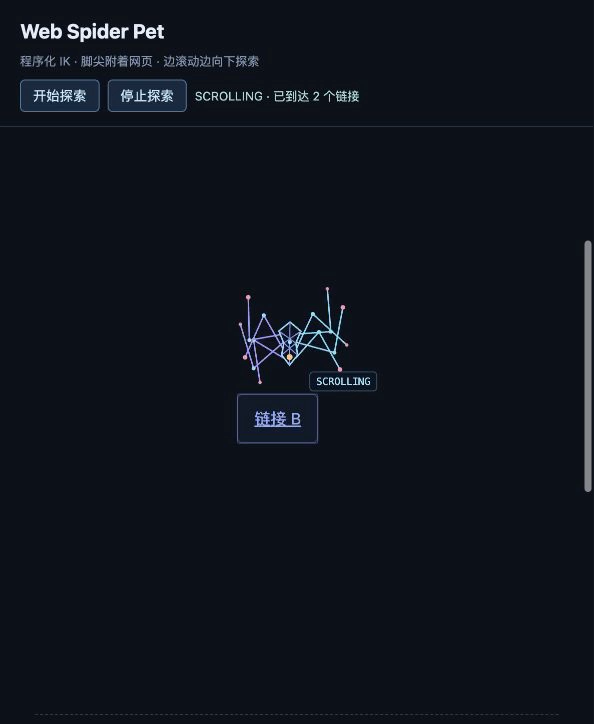

# Web Spider Pet 🕷️

[English](README.md) | **简体中文**

**一只真的会在网页上爬的小蜘蛛。**  
*不只是爬虫——爬虫本身就是蜘蛛。*


Web Spider Pet 把“网络爬虫”这个比喻重新变回一只真的会爬的蜘蛛：它读取真实网页中的链接位置，用程序化 IK 腿在页面上移动，当前区域探索完以后会继续一边爬、一边慢慢向下滚动寻找新的链接。

v0.1 还是一个 **Chromium 浏览器扩展原型**。它现在会在页面上探索，但**不会自动点击链接、不会跨页面导航、没有 AI，也不会把网页内容上传到服务器**。

> 它现在爬的是页面，还不是整个网络——暂时。🕷️

## 演示

[观看约 30 秒的实际速度演示（MP4）](docs/demo/scroll-crawling.mp4)

[](docs/demo/scroll-crawling.mp4)

演示中蜘蛛走向真实 DOM 链接，并在页面滚动时继续使用同一套 IK 支撑与换脚逻辑。视频没有加速，也没有用预制动画替换真实运动。

## 它有什么不同

- **真实网页空间**：目标来自页面实际的 `a[href]` 和 `getBoundingClientRect()`，不是随便画出来的点。
- **程序化八足运动**：每条腿使用 two-bone IK，落脚、伸展、换脚和支撑都由真实身体运动触发。
- **滚动时也在爬**：页面向下滚动时，蜘蛛不会冻结；脚会按网页表面投影继续支撑和迈步。
- **动画对应真实状态**：停止就是停止，扫描就是扫描，不用“装饰动画”假装程序正在工作。
- **不挡网页交互**：Overlay 使用 Shadow DOM 和 `pointer-events: none`。
- **本地运行**：v0.1 没有遥测、后端、AI 或 API Key。

## 快速开始

需要 Node.js 20.19+ 或 22.12+（推荐当前 LTS）和 npm。

```sh
git clone https://github.com/yuddy666/web-spider-pet.git
cd web-spider-pet
npm install
npm run build
```

然后：

1. 打开 Chrome / Chromium 的 `chrome://extensions`。
2. 开启“开发者模式”。
3. 点击“加载已解压的扩展程序”。
4. 选择项目中的 `dist/` 目录。
5. 打开普通 HTTP / HTTPS 网页；已打开的页面需要刷新一次。
6. 打开 Web Spider Pet 扩展弹窗，点击“开始探索”。

“只走一个链接”会让蜘蛛完成一次移动后停下；“开始探索”则会持续走访当前页面里的真实链接，并在需要时慢慢向下探索。

修改源码后重新执行：

```sh
npm run build
```

再到扩展管理页重新加载扩展并刷新测试页面。

## 本地演示页

```sh
npm run demo
```

打开终端给出的地址并进入 `/demo/`。Vite 只提供本地测试页面；浏览器扩展仍然从 `dist/` 加载。

## 当前行为

v0.1 会扫描当前主文档中可见、可达的 HTTP / HTTPS 链接，选择附近尚未抵达的目标并爬过去。连续探索时，每个 DOM 链接在单轮中最多抵达一次，当前上限为 50 个目标。

当当前视口没有新的未探索目标，而页面下方还有内容时，蜘蛛进入 `SCROLLING`：页面以较慢速度向下滚动，同时蜘蛛继续朝下方搜索区域爬行。新的真实链接出现后，它会保留当前朝向、速度和步态状态，平滑切回目标追踪。

当前状态：

| 状态 | 含义 |
| --- | --- |
| `IDLE` | 静止等待；没有模拟工作 |
| `SCANNING` | 扫描并测量真实 DOM 链接 |
| `MOVING` | 向选中的链接移动 |
| `ARRIVED` | 到达链接附近，但没有打开链接 |
| `SCROLLING` | 边爬边缓慢滚动，寻找新的真实链接 |

## v0.1 目前不会做什么

- 不自动点击或打开链接。
- 不跨页面自主导航。
- 不是真正的网络爬虫后端。
- 不包含 LLM / AI Agent。
- 不需要也不保存 API Key。
- 不读取或上传浏览历史。
- 不伪造 `404 / 403 / 429` 等尚未实现的网络状态。

这部分边界是故意保留的：v0.1 先把“**蜘蛛真的会在网页上爬**”这件事做好。

## 技术说明

更详细的 IK、步态、滚动坐标投影、状态机和测试说明放在 [`docs/TECHNICAL.md`](docs/TECHNICAL.md)。

常用检查：

```sh
npm test
npm run typecheck
npm run build
```

## 隐私

v0.1 完全在本地浏览器中运行，不上传网页内容，也没有 analytics / telemetry。完整说明见 [`PRIVACY.md`](PRIVACY.md)。

## 路线图

接下来计划逐步把“小蜘蛛”从规则驱动的页面宠物变成真正可用的 Web Agent：

**browser spider → link navigation → BYOK LLM / Agent → voice input → cross-page exploration → desktop pet**

未来的核心原则不会变：**模型负责决定“去哪、做什么”，现有 locomotion 层负责让蜘蛛真的爬过去。**

## 更新记录

见 [`CHANGELOG.md`](CHANGELOG.md)。

## 许可证

MIT License，见 [`LICENSE`](LICENSE)。